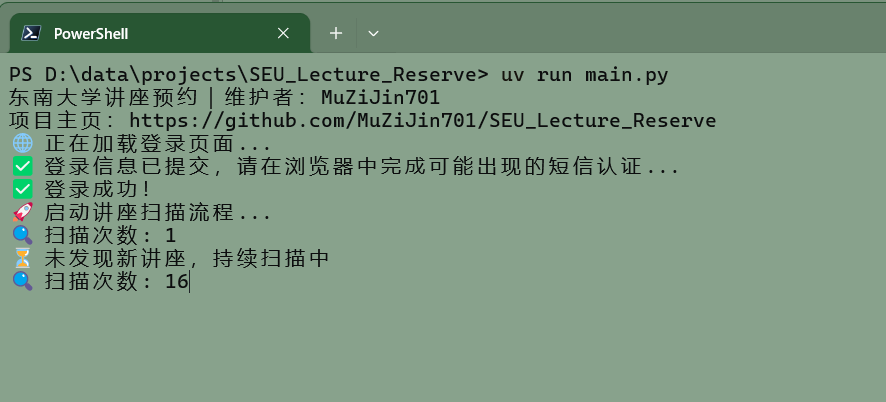

# 东南大学讲座预约 · Playwright 版

[English](README.en.md)

> 实现依据：[浏览器改造规格](docs/browser-upgrade-requirements.md)。离线检查与真实学校验收分开记录，见[验证边界](docs/usage.md#开发与验收)。

通过 Playwright 操作 Chrome，自动查看讲座、填写图形验证码、点击预约并核对结果。所有平台默认显示浏览器，用户通过 `--headless` 选择无头运行。

采用学校已打卡八场、法律／艺术／心理健康各至少一场的选听目标。成功一场后继续；已有预约覆盖缺口时暂停新增，等实际打卡达标后结束。沙龙不预约、不计数。邮件通知可选。



*图片为旧版界面示意，当前规则以下文为准。*

## 快速开始

准备 [uv](https://docs.astral.sh/uv/getting-started/installation/) 和 Google Chrome；项目使用 Python 3.11，无需 ChromeDriver。Linux 还需 Chrome 运行库，见[服务器准备](docs/usage.md#服务器准备)。

```shell
git clone https://github.com/MuZiJin701/SEU_Lecture_Reserve.git
cd SEU_Lecture_Reserve
uv sync --locked
```

首次使用时复制样例；已有 `.env` 时保留原文件：

```shell
cp -n .env.example .env
```

填写项目目录的 `.env`，程序自动读取，进程环境变量优先：

```dotenv
SEU_CARD_NUMBER="你的一卡通号"
SEU_PASSWORD='你的密码'
SEU_PREFERRED_CAMPUS='["无锡校区"]'
```

默认校区为空，只预约线上；名称须与学校系统一致。升级用户请比较 `.env.example`，建议将旧的 `SEU_TIMEOUT_SCAN_INTERVAL` 改为 `10`、`SEU_TIMEOUT_LOGIN_REDIRECT` 改为 `30`；程序不会覆盖已有配置。

先做只读检查，不提交预约、不发邮件、不创建预约任务：

```shell
uv run --locked main.py --check
```

看到 `event=read_only_complete` 后，可启动正式预约：

```shell
uv run --locked main.py
```

正式启动会提交真实预约。每次启动先登录并读取学校记录，即使本地曾标记完成；换机器无需先迁移状态目录。正常无候选时安静等待，默认每十秒一轮；按 `Ctrl+C` 停止，本机重启保留待确认保护，不取消学校预约。同账号在所有机器及两个项目之间只运行一个实例。

## 选择浏览器模式

Windows 和 Linux 使用相同的参数约定：

```shell
uv run main.py
uv run main.py --headless
uv run main.py --check --headless
```

第一条显示窗口，第二条无头预约，第三条无头只读检查。不按操作系统切换，旧 `SEU_HEADLESS` 不再生效。辅助采集入口 `uv run captcha_ocr.py --headless` 遵循同一约定。两者都需 Chrome，Linux 有头还需图形环境；切换模式不改变预约规则。

## 邮件通知与状态

邮件可关闭。使用 Gmail 时只需：

```dotenv
SMTP_USERNAME=your-address@gmail.com
SMTP_PASSWORD='your-app-password'
```

默认使用 `smtp.gmail.com:465`，自己给自己发信。其他邮箱及高级配置见[邮件通知](docs/usage.md#邮件通知)。

```shell
uv run --locked main.py --status
uv run --locked main.py --test-mail
```

`--status` 只看本地任务和进程锁，不打开浏览器。`--test-mail` 会真实发送一封邮件，不登录学校；SMTP 接受后仍需检查收件箱。

## Linux 后台运行

先通过只读检查，并确认没有其他实例：

```shell
mkdir -p -m 700 state
nohup uv run --locked main.py --headless >> state/runner.log 2>&1 < /dev/null &
echo $! > state/runner.pid
```

可在 SSH 断开后运行，不提供服务器重启或进程异常后的自动拉起。停止、日志和恢复见[使用指南](docs/usage.md#后台运行与恢复)。自定义状态目录时同步调整路径。

## 使用边界

- 指定标题仍受类别、校区、线上线下及冲突检查约束；首尾相接也算冲突。
- 提交结果不明时先查原活动，不盲目重试；重启保留待确认结果。
- 不提供短信输入或远程桌面。学校要求人工认证时停止业务，保留任务并按邮件配置通知；邮件不能代替认证。
- Windows 有头和无头的真实登录、只读查询已通过；Linux、真实预约、实际 OCR 和长期运行仍待验收。页面没有历史总数，尚不能证明全历史完整性。
- `.env`、`state/` 和认证数据不要上传。最终预约与选听认定以学校系统为准。

完整配置与开发检查见[使用指南](docs/usage.md)，本次范围见[改造需求](docs/browser-upgrade-requirements.md)。独立的 [HTTPS 项目](https://github.com/MuZiJin701/seu-lecture-reserve-http)保持原状。

维护者：[MuZiJin701](https://github.com/MuZiJin701)。基于 [ApricityWang 的原始项目](https://github.com/ApricityWang/SEU_Lecture_Reserve)继续开发，保留原作者和历史贡献者署名；本次目标统计、状态和邮件逻辑来自维护者的 HTTPS 项目。
